# SimToolReal：只告诉机器人“工具怎么动”，灵巧手就能用上没见过的工具

今天要分享的是Cornell University & Stanford University在RSS 2026的一篇工作，*SimToolReal: An Object-Centric Policy for Zero-Shot Dexterous Tool Manipulation*，这篇论文让搭载灵巧手的机器人在仿真中学会使用各种工具，并能够zero-shot迁移到真实机器人上，为搭载灵巧手的机器人使用工具提供了一种新颖的解决方案。

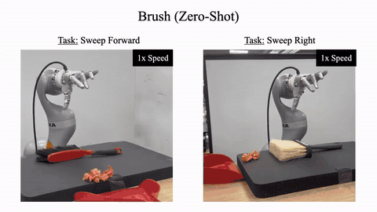

*图1：同一个策略在真机上使用刷子、锤子、马克笔和铲子（文中视频均来自论文项目主页）*

## 1. 为什么“教”灵巧手使用工具不简单

谈到“教会机器人使用工具”，可能包括笔者在内的大多数人想到的首先是模仿学习，但是在灵巧手上，想用模仿学习的方法教机器人用工具，并不简单。

因为模仿学习本质是一种监督学习，通常需要较多的示范数据才能具有较好的泛化性，而目前示范数据主要有两种来源。

**一是遥操作直接采集。** 灵巧手的遥操作负担很重：头显、数据手套、手柄和多路相机往往要同时上阵，标定和操作都不轻松。操作者又几乎得不到力和触觉反馈，抓薄柄、手内转动、顶着接触力干活这类动作很难演示好。

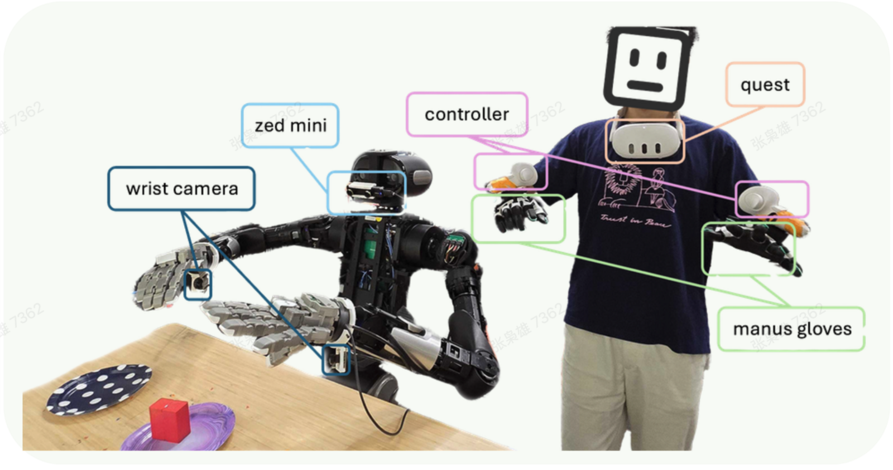

*图2：一套灵巧手遥操作系统的硬件组成，来源:Ego-Pi: VLA Fine-Tuning for Ego-Centric Human and Robot Data, Figure 2*

**二是从人类视频做 retarget。** 思路和人形机器人 locomotion 类似：拍下人手使用工具的视频，把手部运动重定向到机器手上，再用来模仿学习。问题在于人手和机器手几何不一致，指长、关节范围、驱动方式都不同。运动学上对齐了，不代表手与工具的交互也一致。姿态看着像，但手和物体的物理交互并不能保证一致。

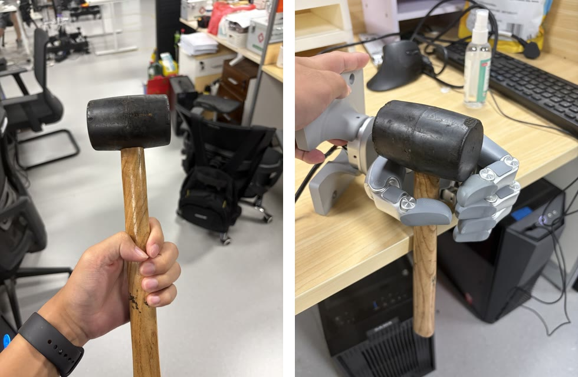

*图3：同一把锤子：人手能稳定环握锤柄，但是同样的抓握动作搬到灵巧手上并不成立*

SimToolReal 因此另辟蹊径。人类视频照样使用，但只从中取**工具该怎么动**；而具体的手臂和手指如何运动，则交给强化学习策略去学。

## 2. Task Formulation

刚性工具的空间状态可以用一个 6D 位姿描述。挥锤这类动作，在工具层面就是一串目标位姿：转正、对准钉子、挥下。论文据此把问题写成目标条件控制：

$$
a_t=\pi_\theta(s_t,\,o_t,\,\phi,\,g)
$$

$s_t$ 是本体感知，$o_t\in SE(3)$ 是工具当前位姿，$g\in SE(3)$ 是目标位姿，$\phi$ 是一个粗略的抓取区域包围盒。输出 $a_t$ 是 7 自由度机械臂加 22 自由度灵巧手，共 29 维的关节位置目标。

一个任务就是一串目标 $\{g^k\}_{k=1}^{K}$。策略每次只看当前目标，满足 $d(o_t,g^k)<\epsilon$ 才切到下一个。距离用工具上 4 个关键点定义：

$$
d(o_t,g)=\max_i\lVert o_{t,i}-g_i\rVert
$$

位置和朝向误差由此合成一个量。

使用工具 6D 位姿的目标序列来作为策略的输入具有与生俱来的泛化优势，换工具、换任务都不用重新训练，也不用重新设计奖励。

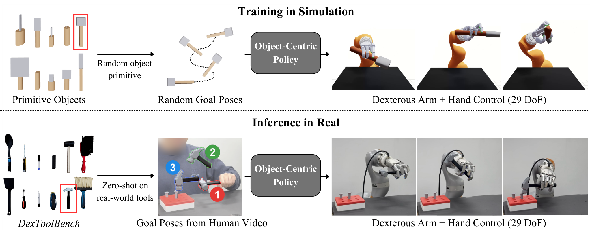

*图4：仿真中学习到达随机位姿，真机上由人类视频提供目标（论文 Fig. 2）*

## 3. 整体架构

在仿真训练阶段，作者程序化生成大量“柄 + 头”结构的基元物体，随机化尺寸、形状和两部分的密度，再随机采样目标位姿。奖励为：

$$
r=r_{\text{smooth}}+r_{\text{grasp}}+\mathbb{I}_{\text{grasped}}\,r_{\text{goal}}
$$

$$
r_{\text{goal}}=\max(d^*-d,\,0)+B_{\text{succ}}\,\mathbb{I}[d<\epsilon]
$$

$d^*$ 记录当前目标下达到过的最小距离，只有比之前更近才有奖励，策略没法停在目标附近刷分。要拿到 $r_{\text{goal}}$，必须先把工具抓起来，抓取和手内转动于是成了必经之路。

actor 是 LSTM，靠交互历史隐式适应没被观测到的质量和几何。critic 是非对称的，可以使用仿真里的特权状态。另有位姿噪声、延迟、外力扰动等域随机化。

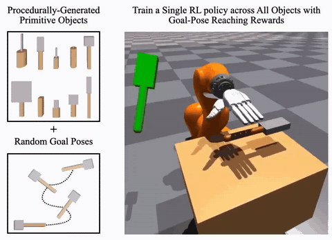

*图5：仿真训练：绿色物体是目标位姿，策略能学会移动手中工具到达目标位姿*

真机部署的时候，人先录一段使用工具的 RGB-D 演示视频。SAM 3D 重建带真实尺度的 mesh，SAM 2 分割出抓取区域，FoundationPose 在视频里跟踪工具得到位姿轨迹，下采样后作为目标序列。

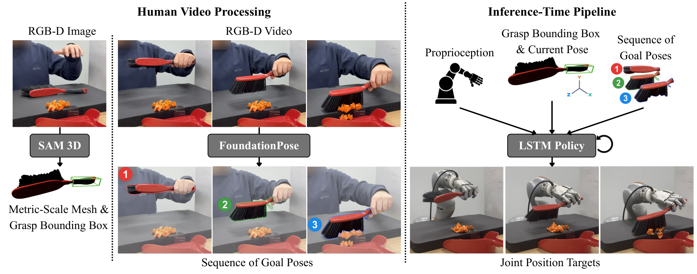

*图6：真机部署流程（论文 Fig. 3）*

## 4. 从 PPO 到 SAPG：上万个环境怎么用才不浪费

29 维动作加上接触丰富的任务，探索是瓶颈。写出 PPO 的目标：

$$
L_{\text{on}}(\theta)=\mathbb{E}_{(s,a)\sim\pi_{\text{old}}}\Big[\min\big(r_tA_t,\ \text{clip}(r_t,1-\varepsilon,1+\varepsilon)A_t\big)\Big],\quad r_t=\frac{\pi_\theta(a_t|s_t)}{\pi_{\text{old}}(a_t|s_t)}
$$

两万多个环境都从同一个高斯策略采样，动作大多挤在均值附近，数据高度重复。SAPG（Split and Aggregate Policy Gradients，ICML 2024）针对这一点做出了改进。

Split and Aggregate Policy Gradients 直接翻译过来是“分离聚合策略梯度”，顾名思义，它的训练主要有分离和聚合两个步骤。

### Split：把环境分给一群策略

把 $N$ 个环境切成 $M$ 块，每块交给一个策略 $\pi_1,\dots,\pi_M$。它们共享主干网络，只靠各自一个可学习的隐向量区分。$\pi_1$ 是 leader，其余是 follower。follower 的目标里加上系数各不相同的熵正则：

$$
L(\pi_j)=L_{\text{on}}(\pi_j)+\lambda_j\,\mathcal{H}\big(\pi_j(\cdot|s)\big),\quad j\ge 2
$$

系数大的敢试，系数小的求稳，leader 不加熵项。SimToolReal 中每块 4,096 个环境，共 6 个策略。

这一步的重要性采样就是 PPO 自带的那个。每个 follower 只用自己环境的数据，行为策略是它自己的 $\pi_{j,\text{old}}$，比值为 $\pi_j/\pi_{j,\text{old}}$，在 $[1-\varepsilon,1+\varepsilon]$ 内裁剪。

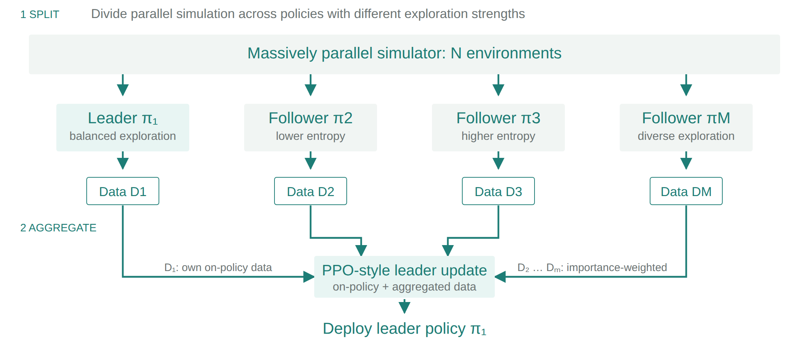

*图7：SAPG 的数据流简要示意图*

### Aggregate：leader 怎么用别人的数据

follower 的数据不是 leader 采的，属于 off-policy 数据。设样本 $(s,a)$ 来自 $\pi_j$，要更新的是 leader $\pi_i$。重要性采样比值的分母是行为策略：

$$
r_i(s,a)=\frac{\pi_i(a|s)}{\pi_j(a|s)}
$$

在裁剪这一步。PPO 的信任域约束的是新策略不能离自己的旧策略太远，而 $r_i$ 衡量的是 leader 与 follower 的差距，天然不在 1 附近。把它拆开：

$$
r_i=\frac{\pi_i(a|s)}{\pi_{i,\text{old}}(a|s)}\cdot\underbrace{\frac{\pi_{i,\text{old}}(a|s)}{\pi_j(a|s)}}_{\mu}
$$

第一项才是信任域要管的量。要求它落在 $[1-\varepsilon,1+\varepsilon]$，等价于让 $r_i$ 落在 $[\mu(1-\varepsilon),\mu(1+\varepsilon)]$。于是 off-policy 损失为

$$
L_{\text{off}}(\pi_i;\mathcal{X})=\frac{1}{|\mathcal{X}|}\sum_{j\in\mathcal{X}}\mathbb{E}_{(s,a)\sim\pi_j}\Big[\min\big(r_iA,\ \text{clip}(r_i,\mu(1-\varepsilon),\mu(1+\varepsilon))A\big)\Big]
$$

其中 $\mathcal{X}$ 是全体 follower。$\mu$ 由采样时的两个策略决定，是常数，不回传梯度。当 $i=j$ 时 $\mu=1$，公式退回普通 PPO。所以分离和聚合用的是同一个式子，区别只在行为策略上。

训练结束后，使用leader策略进行推理。

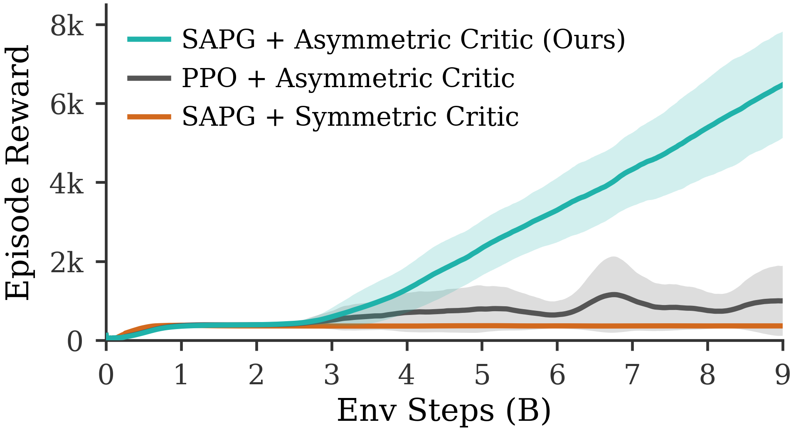

*图8：不同强化学习算法方案 5 个种子平均 reward 与训练 step 的关系曲线（论文 Fig. 8）*

## 5. 实验效果

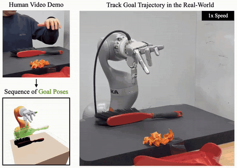

*图9：人类演示、提取出的目标位姿与真机执行*

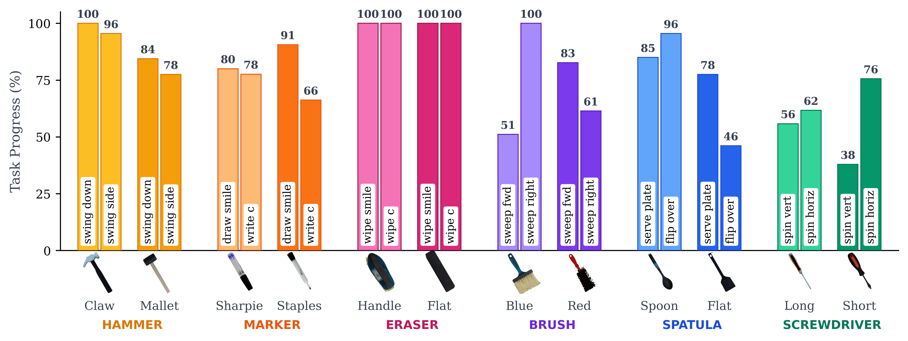

*图10：策略在 24 条任务轨迹的 Task Progress（论文 Fig. 4）*

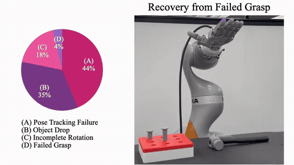

*图11：通过强化学习训练得到的策略具有从失败中恢复的能力，出错之后闭环策略会尝试重新抓取*

**参考资料**

- Kedia, Lum, Bohg, Liu. *SimToolReal: An Object-Centric Policy for Zero-Shot Dexterous Tool Manipulation.* RSS 2026. arXiv:2602.16863
- Singla et al. *SAPG: Split and Aggregate Policy Gradients.* ICML 2024. arXiv:2407.20230
- 项目主页：simtoolreal.github.io
