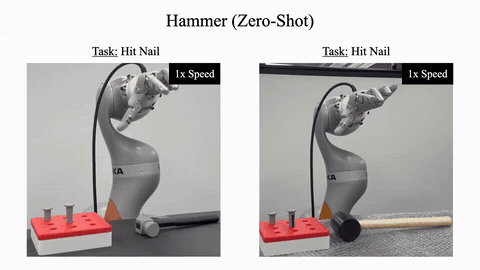
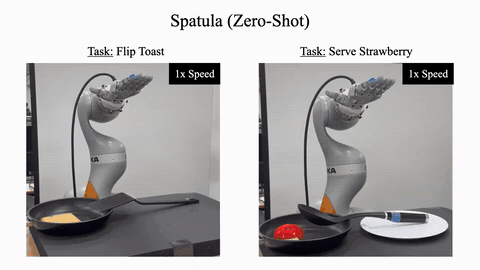

# SimToolReal：只告诉机器人“工具怎么动”，灵巧手就能用上没见过的工具

> 论文：*SimToolReal: An Object-Centric Policy for Zero-Shot Dexterous Tool Manipulation*，RSS 2026，Cornell University & Stanford University

*同一个策略在真机上使用刷子、锤子、马克笔和铲子（文中视频均来自论文项目主页）*

## 1. 灵巧手的示范数据，为什么难采

想让机器人学会用锤子，最直接的路线是遥操作采数据，再做模仿学习。换成灵巧手，这条路处处卡壳：

- **硬件重**。头显、数据手套、手柄和多路相机往往要同时上阵，标定和操作负担都不小。
- **手不一样**。人手和机械手的指长、关节范围、驱动方式都不同，人做得出的环绕式抓握，搬到机械手上常常不成立。
- **接触难演示**。用工具要抓薄柄、在手内转动、顶着接触力干活，动作看着像，不代表接触在物理上站得住。

*一套灵巧手遥操作系统的硬件组成*

SimToolReal 换了一种分工：人只说明**工具该怎么动**，手臂和手指如何实现，交给仿真里的强化学习。

## 2. Task formulation：把工具使用写成位姿到达

刚性工具的状态可以用一个 6D 位姿描述。挥锤这类动作，在工具层面就是一串目标位姿：转正、对准钉子、挥下。论文据此把问题写成目标条件控制：

$$a_t=\pi_\theta(s_t,\,o_t,\,\phi,\,g)$$

$s_t$ 是本体感知，$o_t\in SE(3)$ 是工具当前位姿，$g\in SE(3)$ 是目标位姿，$\phi$ 是一个粗略的抓取区域包围盒。输出 $a_t$ 是 7 自由度机械臂加 22 自由度灵巧手，共 29 维的关节位置目标。

一个任务就是一串目标 $\{g^k\}_{k=1}^{K}$。策略每次只看当前目标，满足 $d(o_t,g^k)<\epsilon$ 才切到下一个。距离用工具上 4 个关键点定义：

$$d(o_t,g)=\max_i\lVert o_{t,i}-g_i\rVert$$

位置误差和朝向误差由此合成一个以厘米计的量。

这个抽象有两个好处。第一，目标序列只是策略的输入，换工具、换任务都不用重新训练，也不用重新设计奖励。第二，目标按“到达”推进，不按时间播放，机器人不必跟上人的节奏。

*仿真中学习到达随机位姿，真机上由人类视频提供目标（论文 Fig. 2）*

## 3. 整体架构：仿真里练本事，真机上给目标

**仿真训练。** 接口里只有位姿，训练时就不需要任何真实工具和任务轨迹。作者程序化生成大量“柄 + 头”结构的基元物体，随机化尺寸、形状和两部分的密度，再随机采样目标位姿。奖励为

$$r=r_{\text{smooth}}+r_{\text{grasp}}+\mathbb{I}_{\text{grasped}}\,r_{\text{goal}}$$

$$r_{\text{goal}}=\max(d^*-d,\,0)+B_{\text{succ}}\,\mathbb{I}[d<\epsilon]$$

$d^*$ 记录当前目标下达到过的最小距离，只有比之前更近才有奖励，策略没法停在目标附近刷分。要拿到 $r_{\text{goal}}$，必须先把工具从桌面抓起来，抓取和手内转动于是成了完成目标的必经之路。

actor 是 LSTM，靠交互历史隐式适应没被观测到的质量和几何。critic 是非对称的，可以使用仿真里的特权状态。此外还有位姿噪声、观测与动作延迟、外力扰动等域随机化。整个训练在 IsaacGym 的 24,576 个并行环境里进行。

*仿真训练：绿色物体是目标位姿*

**真机部署。** 人先录一段 RGB-D 演示视频。SAM 3D 重建带真实尺度的 mesh，SAM 2 分割出抓取区域，FoundationPose 在视频里跟踪工具得到位姿轨迹，下采样到 3 Hz 后作为目标序列。执行时 FoundationPose 以 30 Hz 估计工具位姿，策略以 60 Hz 输出关节目标，权重全程冻结。

*真机部署流程（论文 Fig. 3）*

这里的 zero-shot 指策略不针对新工具、新轨迹再训练。演示视频、点选分割和相机标定仍然需要。

## 4. 从 PPO 到 SAPG：上万个环境怎么用才不浪费

29 维动作加上接触丰富的任务，探索是瓶颈。先写出 PPO 的目标（$\varepsilon$ 为裁剪系数）：

$$L_{\text{on}}(\theta)=\mathbb{E}_{(s,a)\sim\pi_{\text{old}}}\Big[\min\big(r_tA_t,\ \text{clip}(r_t,1-\varepsilon,1+\varepsilon)A_t\big)\Big],\quad r_t=\frac{\pi_\theta(a_t|s_t)}{\pi_{\text{old}}(a_t|s_t)}$$

两万多个环境都从同一个高斯策略采样，动作大多挤在均值附近，环境再多，数据也高度重复。SAPG（Split and Aggregate Policy Gradients，ICML 2024）针对的就是这一点。

### Split：把环境分给一群策略

把 $N$ 个环境切成 $M$ 块，每块交给一个策略 $\pi_1,\dots,\pi_M$。它们共享主干网络，只靠各自一个可学习的隐向量区分。$\pi_1$ 是 leader，其余是 follower。follower 的目标里加上系数各不相同的熵正则：

$$L(\pi_j)=L_{\text{on}}(\pi_j)+\lambda_j\,\mathcal{H}\big(\pi_j(\cdot|s)\big),\quad j\ge 2$$

系数大的敢试，系数小的求稳，leader 不加熵项。SimToolReal 中每块 4,096 个环境，共 6 个策略。

这一步的重要性采样就是 PPO 自带的那个。每个 follower 只用自己那块环境的数据，行为策略是它自己的 $\pi_{j,\text{old}}$，比值为 $\pi_j/\pi_{j,\text{old}}$，在 $[1-\varepsilon,1+\varepsilon]$ 内裁剪。

*SAPG 的数据流：follower 各自探索，leader 聚合经验（自绘示意图）*

### Aggregate：leader 怎么用别人的数据

follower 的数据不是 leader 采的，属于 off-policy 数据。设样本 $(s,a)$ 来自 $\pi_j$，要更新的是 leader $\pi_i$。重要性采样比值的分母必须是行为策略：

$$r_i(s,a)=\frac{\pi_i(a|s)}{\pi_j(a|s)}$$

麻烦出在裁剪上。PPO 的信任域约束的是新策略别离自己的旧策略太远，而 $r_i$ 衡量的是 leader 与 follower 的差距，天然不在 1 附近。把它拆开：

$$r_i=\frac{\pi_i(a|s)}{\pi_{i,\text{old}}(a|s)}\cdot\underbrace{\frac{\pi_{i,\text{old}}(a|s)}{\pi_j(a|s)}}_{\mu}$$

第一项才是信任域要管的量。要求它落在 $[1-\varepsilon,1+\varepsilon]$，等价于让 $r_i$ 落在 $[\mu(1-\varepsilon),\mu(1+\varepsilon)]$。于是 off-policy 损失为

$$L_{\text{off}}(\pi_i;\mathcal{X})=\frac{1}{|\mathcal{X}|}\sum_{j\in\mathcal{X}}\mathbb{E}_{(s,a)\sim\pi_j}\Big[\min\big(r_iA,\ \text{clip}(r_i,\mu(1-\varepsilon),\mu(1+\varepsilon))A\big)\Big]$$

其中 $\mathcal{X}$ 是全体 follower。$\mu$ 由采样时的两个策略决定，是常数，不回传梯度。当 $i=j$ 时 $\mu=1$，公式退回普通 PPO。所以分离和聚合用的是同一个式子，区别只在行为策略是谁。

还有三个细节：

1. **优势是 leader 的。** 式中 $A$ 是 $A^{\pi_{i,\text{old}}}$，要用 leader 的价值函数来估计。
2. **回报只看一步。** 多步回报里后续动作是 follower 选的，不能当作 leader 的回报。off-policy 样本的 critic 目标只用单步 $r_t+\gamma V(s_{t+1})$，on-policy 样本照常用多步回报。
3. **配比一比一。** off-policy 梯度噪声更大。leader 的总损失 $L=L_{\text{on}}+\lambda L_{\text{off}}$ 取 $\lambda=1$，但对 follower 数据下采样，使两类数据量相同。

注意，这个比值只修正了动作分布，状态仍来自 follower 的访问分布。这和 PPO 忽略新旧策略状态分布差异是同一类近似。最终部署的只有 leader。

*仿真训练奖励，5 个随机种子平均（论文 Fig. 8）*

消融中，SAPG 在 90 亿步内持续上升，PPO 停在很低的平台上。保留 SAPG 但改用对称 critic 同样学不动，所以起作用的是两者的组合。

## 5. 实验效果

*人类演示、提取出的目标位姿与真机执行*

真机平台是 KUKA iiwa 14 机械臂加 Sharpa 五指灵巧手。作者提出 DexToolBench：6 类工具、12 个实例、24 条任务轨迹，每条 5 次，共 120 次真机实验，所有工具和轨迹训练时都没见过。指标是 Task Progress，即按顺序到达的目标位姿比例，到达阈值为 2 cm。

*24 条任务轨迹的 Task Progress（论文 Fig. 4）*

橡皮的四条轨迹全部 100%，它几乎只需要平移。螺丝刀最难，既要转到工作姿态又要持续旋转。更薄、更重的工具表现也会下降。按论文逐次数据平均，约为 79%。

*锤子与铲子的真机执行片段*

基线对比在红色刷子扫桌面任务上进行。不需要转工具时，SimToolReal、固定抓取、运动学重定向的 Task Progress 分别为 98.0%、61.0%、8.1%。需要先把刷子转 90° 时，三者为 82.7%、10.8%、0%。固定抓取只能靠手臂转工具，会撞上桌面。运动学重定向不考虑接触力，连刷子都抓不稳。

*出错之后，闭环策略会尝试重新抓取*

失败案例里，位姿跟踪丢失占 43.7%，掉落占 34.5%，手内旋转不到位占 18.2%，抓取失败占 3.6%。感知是眼下最大的短板。

Task Progress 衡量的是位姿轨迹跟踪，不等于钉子敲进去了。螺丝刀任务是空中旋转，没有真的拧螺丝。方法假设工具是刚体，目标序列固定，不做重规划。

## 6. 小结

SimToolReal 的启发在接口设计：“做什么”压缩成物体位姿序列，交给人类视频和感知；“怎么做”交给仿真里练出来的通用控制器。SAPG 则让上万个并行环境真正用在了探索上。

**参考资料**

- Kedia, Lum, Bohg, Liu. *SimToolReal: An Object-Centric Policy for Zero-Shot Dexterous Tool Manipulation.* RSS 2026. arXiv:2602.16863
- Singla et al. *SAPG: Split and Aggregate Policy Gradients.* ICML 2024. arXiv:2407.20230
- 项目主页：simtoolreal.github.io
